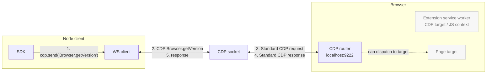
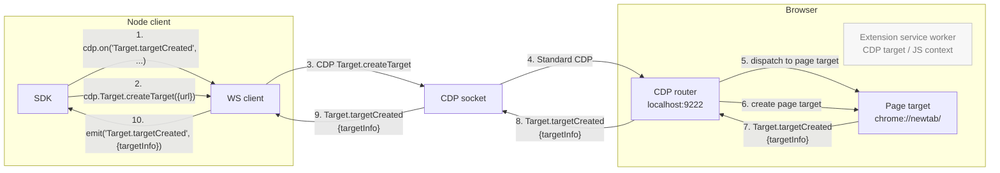
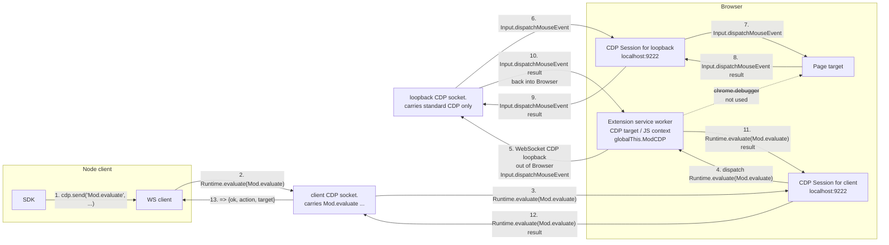
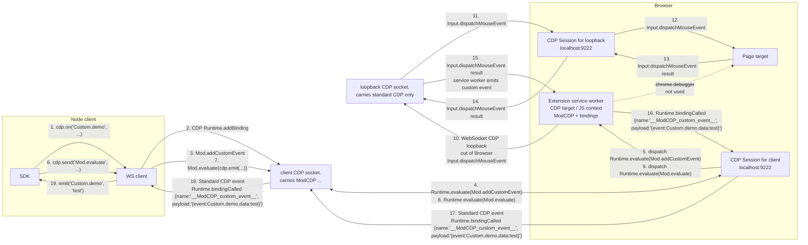

# ModCDP

[English](README.md) | [简体中文](README.zh-CN.md)

CDP is powerful but it's been stretched to many use-cases beyond its initial audience. It is difficult for agents and humans to use without a harness library, because:

- lacks the ability to use it statelessly without maintaining mappings of sessionIds, targetIds, frameIds, execution context IDs, backendNodeId ownership, and event listeners

- lacks the ability to register custom CDP commands, abstractions, and events

- lacks the ability to easily call chrome.\* extension APIs for things like `chrome.tabs.query({ active: true })`

- _lacks the ability to reference pages and elements with stable references across browser runs, such as XPath, URL, and frame index, instead of unstable identifiers like sessionId, targetId, frameId, backendNodeId_ (unrealistic dream? maybe not)

While I had high hopes for WebDriver BiDi, unfortunately it solves almost none of these issues.

ModCDP does not aim to solve all of these issues directly either. Instead it solves a simpler problem: allowing us to customize and extend CDP with new commands.
Then we use those basic primitives to fix the shortcomings in CDP by implementing our own custom events (all sent over a normal CDP websocket to a compatible browser).

| Primitive              | What it does                                                                                          |
| ---------------------- | ----------------------------------------------------------------------------------------------------- |
| `Mod.evaluate`         | Run an expression in the ModCDP extension service worker, with `chrome.*` and a `cdp` bridge in scope |
| `Mod.addCustomCommand` | Register a `Custom.*` method handler that lives in the SW                                             |
| `Mod.addCustomEvent`   | Register a `Custom.*` event your SW handlers can `emit()`                                             |
| `Mod.addMiddleware`    | Intercept service-worker-routed requests, responses, or events by name or `*`                         |

Instead of inventing yet another browser driver library, ModCDP fixes the issue at the root.

ModCDP exposes a CDP-shaped interface for unmodified clients such as Playwright and Puppeteer. Compatibility depends on the transport, browser capabilities, and commands used; extension-only mode implements a subset of browser-level CDP. See [existing-browser mode](#reverse-proxy-mode) for the verified scope and limitations.

You can send `Mod.*`, `Custom.*`, etc. through standard Playwright/Puppeteer/other-driver-managed CDP sessions; `js/examples/demo.ts` demonstrates the flow.

## Repository components

The JavaScript SDK, browser extension, and Snow Browser plugin share the browser-side implementation.

| Directory              | Responsibility                                                                                          | Use it when                                                            |
| ---------------------- | ------------------------------------------------------------------------------------------------------- | ---------------------------------------------------------------------- |
| `js/`                  | TypeScript/JavaScript client, Node proxy/CLI, browser-side server implementation, and development tools | Running the current proxy, using the JS SDK, or building the extension |
| `extension/`           | Shared browser extension entry point and static pages; reuses server logic from `js/`                   | Installing the bridge in the controlled browser                        |
| `plugin/`              | Shared local MCP runtime and launcher                                                                   | Operating Snow Browser through Codex or Claude Code                    |
| `skills/snow-browser/` | Shared skill source                                                                                     | Browser selection, operation, and cleanup instructions for both hosts  |

Extension builds write only to `dist/`. The standalone Node proxy remains available alongside the plugin.

## Install and build

For the Node proxy and extension build, install **Node ≥ 22** and **pnpm 10.33.2**, then run from the repository root:

```sh
pnpm install --frozen-lockfile
```

Installation runs `prepare`, which builds the package and extension. There is no separate package-level `install` script. Windows uses PowerShell to create the extension ZIP; other platforms need `zip` on PATH. These are source-development requirements; plugin users only need Node ≥ 22 and the installed Snow Browser.

```sh
pnpm run build                    # TypeScript output and default extension assets
pnpm run build:package            # TypeScript output only
pnpm run build:extension-assets   # Default extension assets only; ReverseWS and NATS disabled
pnpm run build:plugin             # Portable Codex / Claude Code marketplace with bundled runtime
```

Outputs include `dist/js/`, the unpacked extension in `dist/extension/`, and `dist/extension.zip`. Building does not reload an installed extension or watch files.

For standalone SDK usage, choose one of the [proxy shortcuts](#proxy-shortcuts-and-paseo) below. The Snow Browser plugin is described in the next section. Existing-browser mode supports browsers with external CDP access disabled, provided extension installation and `chrome.debugger` access are allowed. It does not bypass browser or administrator restrictions on those capabilities.

## Snow Browser plugin for Codex and Claude Code

The plugin distribution entry is [itMrBoy/cdpHelper](https://github.com/itMrBoy/cdpHelper), on its `main` branch. Its root holds the Codex and Claude Code marketplaces, `plugins/snow-browser/` holds the compiled plugin and production dependencies, and `source/ModCDP` is the source submodule. This ModCDP repository maintains source, builds, and tests; its root is not the installable marketplace. The distribution repository and Release still require publication and end-to-end acceptance before these are advertised as ready.

Users need Node ≥22 and Snow Browser; no npm/pnpm install, local build, or Chromium download is required. The browser extension is a separate Release asset, planned as `snow-browser-extension-v0.1.0.zip` under tag `v0.1.0`; it is not published yet. Users download and unpack it, then manually load the `extension/` subdirectory containing `manifest.json` in each target profile; the ZIP root is not loadable. The plugin does not accept extension directories, download/copy extension resources, or write connection configuration into a shared extension folder. Profile identity lives in extension storage.

Each session first calls `browser_status`, displays the registered instances with names, short IDs and states, and asks a single question offering those instances plus a new isolated Snow instance. Do not ask a generic mode question before listing the inventory. Ordinary profiles register through `127.0.0.1:29393/bridge`. For reuse, `browser_status` shows an inventory with short numbers; after the user chooses, the skill passes that instance's UUID to `browser_select({mode:"reuse", instance_id:"<UUID>"})`. Isolated mode uses `browser_select({mode:"isolated"})` to request a separate profile and associate the extension using a one-time startup URL. The URL proves the requested launch, not that Snow kept a separate profile: Snow may exit the new process or open the URL in an existing window. Before accepting an owned connection and before each owned page operation, the broker verifies a live process with the exact owned profile and executable; failure detaches the connection and sends no page operation. This verification currently exists only on Windows. Other platforms fail closed for isolated mode; reuse is unaffected. Real Snow isolated-mode acceptance is not complete. Both modes use Playwright through the bridge; Computer Use may only launch Snow.

Different tabs can run concurrently, with one owner per tab. Disconnects invalidate old references: users explicitly select again before tabs are rediscovered and bound, without automatic rebind or side-effect replay. Before leaving an isolated instance, ask whether to close and clean its profile; absent consent, retain it. Reused browsers and their tabs remain open. See [installation and connection](skills/snow-browser/references/setup.md). Plugin-format validation and runtime tests do not establish upstream redistribution authorization.

## Use the JS SDK

```ts
import { ModCDPClient } from "modcdp";
import { z } from "zod";

const upstream_ws_cdp_url = "http://127.0.0.1:9222"; // host:port, http(s), and ws(s) URLs work
const cdp = new ModCDPClient({
  launcher: { launcher_mode: "remote" },
  upstream: { upstream_mode: "ws", upstream_ws_cdp_url },
  injector: { injector_mode: "discover" },
  router: { router_routes: { "Target.getTargets": "service_worker" } },
  server_config: {
    upstream: { upstream_ws_cdp_url },
    router: { router_routes: { "*.*": "loopback_cdp" } },
  },
});
await cdp.connect();

// use it like a normal CDP connection, send normal CDP, register for normal CDP events
console.log(await cdp.Browser.getVersion());
cdp.on(cdp.Target.targetInfoChanged, console.log);

// run extension code with chrome.* in scope
const tab = await cdp.Mod.evaluate({
  expression: "(await chrome.tabs.query({ active: true }))[0]",
});

// ✨ register and use custom CDP commands
await cdp.Mod.addCustomCommand({
  name: "Custom.tabIdFromTargetId",
  params_schema: { targetId: cdp.types.zod.Target.TargetID },
  result_schema: { tabId: z.number().nullable() },
  expression: `async ({ targetId }) => ({
    tabId: (await chrome.debugger.getTargets()).find(t => t.id === targetId)?.tabId ?? null
  })`,
});
const { targetInfos } = await cdp.Target.getTargets();
const pageTarget = targetInfos.find((targetInfo) => targetInfo.type === "page");
console.log(await cdp.send("Custom.tabIdFromTargetId", { targetId: pageTarget.targetId })); // -> { tabId: 22352432 }

// ✨ set up new custom CDP events to fire + receive them just like normal CDP
// this example sets up a truly accurate "foreground focus" tracking event,
// which CDP doesn't have natively https://issues.chromium.org/issues/497896141
const PageForegroundPageChanged = z
  .object({
    targetId: cdp.types.zod.Target.TargetID.nullable(),
    tabId: z.number(),
  })
  .passthrough()
  .meta({ id: "Page.foregroundPageChanged" });

await cdp.Mod.addCustomEvent(PageForegroundPageChanged);
await cdp.Mod.evaluate({
  expression: `chrome.tabs.onActivated.addListener(async ({ tabId }) =>
    cdp.emit("Page.foregroundPageChanged", {
      tabId,
      targetId: (await chrome.debugger.getTargets()).find(t => t.tabId === tabId)?.id ?? null
    })
  )`,
});
cdp.on(PageForegroundPageChanged, console.log);

// ✨ Intercept, modify, and extend existing CDP commands/results/events on the wire
await cdp.Mod.addMiddleware({
  name: cdp.Target.getTargets,
  phase: cdp.RESPONSE,
  // attach .tabId next to every .targetId in events browser emits
  expression: `async (payload, next) => {
    for (const targetInfo of payload.targetInfos) {
      const { tabId } = await cdp.send("Custom.tabIdFromTargetId", {
        targetId: targetInfo.targetId,
      });
      targetInfo.tabId = tabId;
    }
    return next(payload);
  }`,
});
console.log(await cdp.Target.getTargets()); // TargetInfo entries now include tabId

// typed + zod-enforced imperative aliases are generated for standard CDP too
const created = await cdp.Target.createTarget({ url: "https://example.com" });
await cdp.Target.activateTarget({ targetId: created.targetId }); // triggers Page.foregroundPageChanged
console.log(created);
```

## Run the demos

Each demo launches a compatible browser with the fixed ModCDP extension artifact loaded, headful on macOS and `--headless=new` on Linux, then exercises raw CDP, `Mod.evaluate`, `Custom.*` commands, custom events, middleware, and latency reporting in the chosen mode. When stdin is a TTY, the demo leaves you in a mini REPL/TUI.

```sh
pnpm run demo:js                    # defaults to --loopback --upstream=ws
pnpm run demo:js -- --debugger --upstream=pipe
pnpm run demo:js -- --loopback --upstream=reversews
```

Set `CHROME_PATH=/path/to/chromium` to force a specific browser binary. Native messaging mode requires the browser to launch the configured native host; it is not a standalone shell demo mode.

## Transparent Proxy

Upgrade any vanilla CDP client like Stagehand, Playwright, or Puppeteer transparently with support for `Mod.*` / `Custom.*` commands and events.

```sh
pnpm run proxy -- --upstream-mode=ws --upstream-ws-cdp-url=http://127.0.0.1:9222 --port 9223
pnpm run proxy -- --launcher-mode=local --upstream-mode=pipe --port 9223
# ReverseWS/NATS need an explicitly enabled extension build; see below.
# const browser = await playwright.chromium.connectOverCDP("http://127.0.0.1:9223")
# const session = await browser.contexts()[0].newCDPSession(page)
# await session.send("Mod.evaluate", { expression: "1 + 1" }) // -> 2
# ✨ All ModCDP commands now work through playwright! you can modify/extend playwright behavior to your heart's content
```

The proxy uses the same `--launcher-*`, `--injector-*`, `--upstream-*`, `--client-config='{"client_cdp_send_timeout_ms": 10000}'`, `--router='{"router_routes": {...}}'`, and `--server-config='{"router": {"router_routes": {...}}}'` config groups as `ModCDPClient`. CLI flags use kebab case and map to the owner-prefixed config fields, for example `--launcher-local-executable-path` maps to `launcher.launcher_local_executable_path`. `ws` keeps a transparent websocket-to-websocket fast path; `pipe`, `nativemessaging`, `nats`, and launched `reversews` proxy downstream CDP-shaped messages through the selected client-side `ModCDPClient` transport.

Native messaging mode uses the configured browser native host name directly. The baked extension expects the default `com.modcdp.bridge` host, so changing `--upstream-nativemessaging-host-name` requires using an extension build that was baked for that host. Because the browser owns native host process launch and stdio, native messaging is not a standalone `pnpm run proxy` mode.

### Proxy shortcuts and Paseo

Run either shortcut from the repository root, in a terminal or through Paseo:

```sh
pnpm run proxy-local       # Launch an independent browser when a client connects
pnpm run proxy-existing    # Use an already running browser through its extension
```

The complete commands live in `package.json`; `paseo.json` delegates to these pnpm scripts. Its `install` shortcut and worktree setup both use `pnpm install --frozen-lockfile` (see [installation](#install-and-build)).

Two proxy shortcuts share `http://127.0.0.1:9223`; stop one before starting the other. They use ordinary script entries because Paseo rejects duplicate ports across service entries, even when the services are stopped. Connect directly to the address above; Paseo service health checks and proxy URLs are not enabled for these entries.

- `proxy-local` starts a proxy that launches an independent browser when a CDP client connects, loading the built extension from `dist/extension`. It uses the project's browser discovery logic; use an installed browser build that supports `--load-extension`.
- `proxy-existing` connects to an existing browser through its ModCDP extension, without a native browser debugging port. It builds with ReverseWS enabled and NATS disabled, then listens for the extension on `127.0.0.1:29292` before accepting a CDP client on `127.0.0.1:9223`. Load/reload this build in the existing browser. It supports one CDP client at a time and retains the extension connection between clients. Stopping this proxy leaves the existing browser running; stop/reload the reverse-enabled extension too if the proxy will remain stopped, to avoid connection-refused retries.

Both shortcuts rebuild before starting and do not watch source files. Restart the selected script after source changes. A listening proxy port alone does not establish that the upstream browser and extension are ready. In existing-browser mode the extension can connect before a CDP client; the first client waits for that connection if necessary.

### Reverse proxy mode

Use reverse mode when the browser does not expose a public CDP websocket to the final client, but the ModCDP extension can open a websocket back to a local proxy. After building and loading a reverse-enabled extension as described below, the built CLI serves a normal-looking CDP endpoint to Playwright, Puppeteer, Stagehand, or any other CDP client:

```sh
node dist/js/src/proxy/cli.js --launcher-mode=none --upstream-mode=reversews --upstream-reversews-bind=127.0.0.1:29292 --injector-mode=none --port 9223
node dist/js/src/proxy/cli.js --launcher-mode=local --upstream-mode=reversews --injector-mode=cli --injector-cli-extension-path=dist/extension --port 9223
node dist/js/src/proxy/cli.js --launcher-mode=local --upstream-mode=reversews --injector-mode=cli --injector-cli-extension-path=dist/extension --upstream-reversews-bind=127.0.0.1:29293 --port 9223
# const browser = await playwright.chromium.connectOverCDP("http://127.0.0.1:9223", { noDefaults: true })
```

ReverseWS and NATS connections are disabled in the default extension build. Normal `pnpm install`, `pnpm run build`, and `proxy-local` keep them disabled, so ordinary WebSocket/CDP use does not retry connections to unused ports 29292 and 4223. `proxy-existing` explicitly enables ReverseWS after the ordinary build; it runs the built CLI directly to avoid overwriting that choice. After rebuilding, open the extension manager (`chrome://extensions` where supported), enable developer mode, and use Load unpacked to select this checkout's `dist/extension` directory. Use Reload for an already installed copy; clear historical errors to check that no new connection errors appear. Do not load the source `extension/` directory, whose service worker is not bundled.

For a manually loaded extension, check its source directory on the extension's Details page. Rebuilding a Paseo worktree does not update an extension loaded from another checkout: load that worktree's `dist/extension`, or copy the new extension assets to the existing source directory before reloading. Starting `proxy-local` only injects the extension into the independent browser it launches; it does not update extensions in an already running browser.

The extension implements browser-level target discovery and flattened CDP sessions over real `chrome.debugger` attachments. Use Playwright >= 1.60 with `chromium.connectOverCDP('http://127.0.0.1:9223', { noDefaults: true })` for this extension-only endpoint. `noDefaults` avoids browser-level download overrides and page emulation defaults; unsupported browser commands return errors. The adapter exposes ordinary tabs in the current normal profile, including their child iframe sessions (engine version ≥ 125), and excludes internal DevTools/browser pages and incognito tabs. It does not implement isolated browser-context creation or arbitrary native browser operations. Browser version and UA come from the extension's actual environment; revision and V8 version are empty because this API does not provide them.

To verify the existing-browser endpoint using unmodified Playwright, run `node js/scripts/verify-existing-playwright.mjs http://127.0.0.1:9223 example.com`. It checks an already open matching tab, JavaScript evaluation, DOM, screenshot, metrics, CPU profile, and Trace, and saves a report in a temporary directory. The report separates `accessOk` from individual performance capabilities; its exit code is nonzero if any check fails. A running listener or a successful `Mod.evaluate` does not establish Playwright compatibility. Frontend disconnect sends a private ReverseWS lifecycle message so the extension releases its page attachments without closing the browser or the extension connection.

Unmodified Playwright 1.60 was verified through this ModCDP endpoint on an existing browser with external CDP access disabled: existing-page discovery, evaluation, DOM access, screenshots, metrics, CPU profiling, and Trace collection. The independent-browser regression also covers cross-site iframes, tab creation/closure, and sequential reconnection; those checks do not establish the same coverage on every existing browser. Other tools and unsupported browser commands need separate acceptance tests.

For reverse mode, explicitly build an extension that connects to the local reverse connector at `ws://127.0.0.1:29292`:

```sh
pnpm run build
pnpm run build:extension-assets -- --enable-reversews
node dist/js/src/proxy/cli.js --launcher-mode=local --upstream-mode=reversews --injector-mode=cli --injector-cli-extension-path=dist/extension --port=9223
```

For NATS, run `pnpm run build:extension-assets -- --enable-nats` after the ordinary build, start a NATS server with a WebSocket listener at `ws://127.0.0.1:4223`, then run the built CLI with `--upstream-mode=nats` and the same local-launcher/CLI-injector flags. Both build flags can be supplied together. Run the built CLI directly: `pnpm run proxy` rebuilds the extension with the default connections disabled. Existing browser profiles must reload the newly built extension before connecting.

Custom extension entry points can pass `{ enable_reversews: true, enable_nats: true }` as the optional second argument to `new ModCDPServer(config, startupOptions)`. These startup choices are retained across repeated `start()` calls; they are not part of the `Mod.configure` wire contract. Native Messaging startup is unchanged.

In an enabled reverse build, the proxy/client listens for that extension connection. Keep `--upstream-reversews-bind` when using a custom extension build whose compiled autoconnect URL points at a different host or port. `--upstream-reversews-wait-timeout-ms` controls how long the proxy/client waits. Once connected, the extension identifies itself as a ModCDP service worker and the proxy uses that reverse websocket as its client-side transport. From the service worker server's perspective, reversews is a downstream client connection. `Mod.*`, expression-backed `Custom.*` commands, custom event fanout, middleware, and normal CDP commands all stay routed through `globalThis.ModCDP.handleCommand(...)` in the service worker.

Reverse mode is intentionally scoped to one local browser and one reverse extension connection per proxy process. The browser may still have other extensions installed; ModCDP does not require `--disable-extensions-except`.

### Minimal Playwright connection

Start `pnpm run proxy-existing`, load/reload the resulting extension, and open `https://example.com` in the existing browser first. Save this as an `.mjs` file in the repository and run it with Node:

```js
import { chromium } from "playwright";

const browser = await chromium.connectOverCDP("http://127.0.0.1:9223", {
  noDefaults: true,
});
try {
  const context = browser.contexts()[0];
  const page = context?.pages().find((page) => page.url().startsWith("https://example.com/"));
  if (!page) throw new Error("Open https://example.com in the existing browser first");
  console.log(await page.title());
  console.log(await page.evaluate(() => document.visibilityState));
} finally {
  await browser.close(); // Disconnects this CDP client; leaves the independently opened browser running
}
```

Use the existing context; creating isolated browser contexts is unsupported in this mode. Only one CDP client can connect at a time: disconnect other automation sessions before running the example or verification script.

### Connection checks and troubleshooting

| Symptom                                                | Check or action                                                                                                                                                                                                                                                                                                                          |
| ------------------------------------------------------ | ---------------------------------------------------------------------------------------------------------------------------------------------------------------------------------------------------------------------------------------------------------------------------------------------------------------------------------------- |
| Proxy listening, but no pages or connection waits      | `http://127.0.0.1:9223/json/version` only proves the proxy listener is up. `/json` and `/json/list` also advertise a proxy browser endpoint, not actual page targets. Confirm the extension service worker connects to `ws://127.0.0.1:29292`; then run the Playwright verification command above against an already open ordinary page. |
| Port already in use                                    | Stop the other shortcut or the known process using the port. Both shortcuts use 9223; existing-browser mode also needs 29292.                                                                                                                                                                                                            |
| Reverse connection refused repeatedly                  | Start `proxy-existing`, or disable/rebuild and reload the reverse-enabled extension when that proxy is no longer needed. Default builds have ReverseWS off.                                                                                                                                                                              |
| Changes have no effect                                 | Check the extension's source directory, restart the shortcut to rebuild, then reload that exact `dist/extension`. Running a normal build later disables ReverseWS again.                                                                                                                                                                 |
| A second client is rejected                            | Existing-browser mode supports one CDP client at a time. Release the first connection before reconnecting.                                                                                                                                                                                                                               |
| Unsupported browser command or initialization error    | Use Playwright ≥ 1.60 with `noDefaults: true`. The adapter cannot supply every native browser operation, isolated context, internal page, or incognito target.                                                                                                                                                                           |
| No debugger attachment                                 | Confirm extension installation, `chrome.debugger` permissions, and browser policy allow it; close conflicting debugging sessions if needed.                                                                                                                                                                                              |
| Screenshot differs while the page is in the background | Retry with the target tab in the foreground and compare. Capture depends on browser visibility/rendering behavior; background capture behavior is not a universal guarantee.                                                                                                                                                             |

## Routing modes

`Mod.*` and `Custom.*` always go through the extension service worker. Routing only changes how _standard_ CDP methods (`Browser.*`, `Page.*`, `DOM.*`, …) are serviced:

| Demo CLI Flag | Standard CDP path                                                  | Use when                                                                        |
| ------------- | ------------------------------------------------------------------ | ------------------------------------------------------------------------------- |
| `--loopback`  | client → SW → SW dials its own WS back to localhost:9222 → CDP     | Default. You need the SW to intercept/inspect/rewrite normal traffic.           |
| `--debugger`  | client → SW → `chrome.debugger.sendCommand` against the active tab | The browser exposes no remote CDP port and you only have extension permissions. |
| `--direct`    | client → sends non-ModCDP commands to browser CDP directly         | You already have a CDP endpoint and don't need extension interception.          |

Pass via `router: { router_routes: { "*.*": "direct_cdp" | "service_worker" } }` and `server_config: { router: { router_routes: { "*.*": "loopback_cdp" | "chromedebugger" } } }`. The demos default to `--loopback` (the most powerful mode).

## Repository layout

```
extension/                MV3 extension shell and static pages
  manifest.json
  src/
    pages/
js/                       TypeScript client/server/proxy package
  src/
    client/
    server/
    launcher/
    injector/
    transport/
    router/
    translate/
    proxy/
    types/
  examples/
  test/
plugin/                   Local MCP runtime, launcher, and acceptance tests
skills/snow-browser/      Shared Codex / Claude Code skill source
dist/                     Built JS, extension, ZIP, and plugin-marketplace artifacts
```

## Requirements

- **Required for the current Node proxy:** Node ≥ 22, pnpm 10.33.2, and a compatible browser with the required MV3 extension APIs (manifest minimum engine version 116; child iframe sessions need ≥ 125). Existing-browser mode requires extension installation and usable `chrome.debugger` permissions; a public native CDP endpoint is not required.
- **Plugin users:** Node ≥ 22 and an installed Snow Browser with extension/debugger permissions. The plugin bundles runtime dependencies and requires manual extension loading in the selected profile.
- **Local-launch mode:** a browser build that supports `--load-extension=<path>`. Set `CHROME_PATH` to the executable if automatic discovery selects an unsuitable build. Loading via `Extensions.loadUnpacked` is only possible when the connected browser exposes that CDP domain.
- **Direct/loopback mode:** an accessible native CDP endpoint and the extension installed in the same profile. Where supported, `chrome://inspect/#remote-debugging` can expose the current browser; this is optional and separate from existing-browser ReverseWS mode.

### Development commands

```sh
pnpm run typecheck
pnpm run test                     # Rebuilds; needs suitable browsers for integration tests
pnpm run lint
pnpm run format:check
```

The following architecture notes and wire diagrams describe the default native-CDP/loopback flow unless they explicitly mention reverse mode.

---

<details>
<summary><b>Architecture &amp; lifecycle</b></summary>

### Connect

1. Select a `launcher` class and an `upstream` transport. `launcher.launcher_mode="local"` starts a local browser, `launcher.launcher_mode="remote"` uses the supplied `upstream.upstream_ws_cdp_url`, and `launcher.launcher_mode="none"` leaves browser lifecycle outside ModCDP.
2. The configured extension injector classes try discovery, launch-arg injection, Browserbase upload, `Extensions.loadUnpacked`, or borrowing in the configured order.
3. Attach a session to that SW target and `Runtime.enable` on it.
4. Call `globalThis.ModCDP.configure(...)` to push the resolved loopback websocket and any explicit server route overrides into the SW. The clients do this automatically by default.

Reverse proxy mode flips the bootstrap direction: `js/src/proxy/proxy.ts --upstream-mode=reversews --port 9223` listens for the extension on the configured reverse connector while still serving downstream clients from the proxy port. The service worker sends a `modcdp.reverse.hello` message and then accepts CDP-shaped command messages from the proxy. The proxy maps downstream request IDs to reverse request IDs and forwards reverse events back to the downstream CDP client.

### Send

- `Mod.evaluate({ expression, params, cdpSessionId })` → `Runtime.evaluate` on the ext session, wrapping the expression with an IIFE that exposes `params` and `cdp = ModCDP.attachToSession(...)`.
- `Mod.addCustomCommand({ name, expression, ... })` → `Runtime.evaluate` calling `globalThis.ModCDP.addCustomCommand({ ... })` with the user expression embedded as the handler.
- `Mod.addCustomEvent(EventSchema.meta({ id }))` → `Runtime.evaluate` registering the event in `globalThis.ModCDP`; all custom events are delivered through the single `__ModCDP_custom_event__` binding installed at connect time.
- `Mod.addMiddleware({ name, phase, expression })` → `Runtime.evaluate` registering a service-worker middleware for `phase: "request" | "response" | "event"`. Use `name: "*"` to match every method/event in that phase, or pass generated names like `cdp.Target.targetInfoChanged`.
- `Custom.X(params)` → `Runtime.evaluate` calling `globalThis.ModCDP.handleCommand("Custom.X", params, cdpSessionId)`.

In reverse mode, expression-backed commands cannot use `new Function` directly because MV3 extension CSP blocks unsafe eval. The service worker evaluates user expressions by attaching `chrome.debugger` to its own service-worker target and issuing `Runtime.evaluate`, preserving the normal ModCDP expression surface without weakening extension CSP.

### Receive

When SW handlers `cdp.emit('Custom.X', payload)`, the SW invokes `globalThis.__ModCDP_custom_event__(JSON.stringify({ event, data, cdpSessionId }))`. CDP delivers `Runtime.bindingCalled` on the ext session; the client (or proxy) decodes the payload and re-dispatches it as a normal `cdp.on('Custom.X', ...)` event.

In reverse mode, the same `publishEvent(...)` path also sends CDP-shaped event messages over the reverse websocket, so custom events and mirrored upstream events fan out through the standalone proxy to the downstream client.

### Why this works

`Runtime.addBinding` is the only out-of-page → in-page → out-of-page channel CDP exposes. Combined with one extension service worker (which gets `chrome.*` access as a side effect of being in an extension), you get:

- A guaranteed JS execution context that's not a page, with the right permissions
- A way to push named events back through the same CDP socket your client already speaks
- The same command/event surface whether the bytes arrive by websocket, pipe, native messaging, reverse websocket, or NATS.

</details>

<details>
<summary><b>Routing details</b></summary>

```ts
type CDPUpstream = "service_worker" | "direct_cdp" | "auto" | "loopback_cdp" | "chromedebugger";

// client-side defaults
const client_routes = { "Mod.*": "service_worker", "Custom.*": "service_worker", "*.*": "service_worker" } as const;

// server-side defaults (inside the SW)
const server_router_routes = { "Mod.*": "service_worker", "Custom.*": "service_worker", "*.*": "auto" } as const;
```

- **`service_worker`** — handle in the extension SW.
- **`direct_cdp`** (client only) — send straight to the browser CDP websocket.
- **`auto`** (server only) — try `loopback_cdp` first, fall back to `chromedebugger`.
- **`loopback_cdp`** (server only) — SW dials a CDP websocket reachable from the browser. You may pass `http://host:port` as shorthand, but it is resolved to the concrete `ws://.../devtools/...` URL at configuration time. Useful for `Browser.*` commands that `chrome.debugger` doesn't support.
- **`chromedebugger`** (server only) — `chrome.debugger.sendCommand` against `params.debuggee || { tabId, targetId, extensionId }`, defaulting to the active last-focused tab.

Route resolution is **deterministic**: exact-method match → longest-prefix wildcard → `*.*` fallback. This prevents key insertion order from shadowing a more specific route.

When server-side `auto` routing tries loopback CDP discovery, the SW only trusts `127.0.0.1:9222` after verifying a per-connection `server_config.server_browser_token` against its own service-worker target. It will not accidentally route loopback commands through a different browser that happens to have the same extension installed.

</details>

<details>
<summary><b>Wire diagrams</b></summary>

#### 1. Normal CDP Call / Response



#### 2. Normal CDP Event Listener / Event



#### 3. ModCDP Custom Call / Response



The same transport shape applies to `Mod.addCustomCommand`: the client installs a named command handler in the service worker, and later `cdp.send('Custom.someCommand', params)` is routed back through `globalThis.ModCDP.handleCommand(...)`.

#### 4. ModCDP Custom Event Listener / Event



</details>

<details>
<summary><b>Constraints &amp; alternatives explored</b></summary>

**Constraints**

- This does not add real CDP methods to the browser — the wire methods stay `Runtime.evaluate` + `Runtime.bindingCalled`. The `Mod.*` / `Custom.*` namespace is a client + SW convention.
- Page JS does not see custom commands or event bindings.
- A supported browser's `chrome://inspect/#remote-debugging` toggle can expose the current browser at `localhost:9222` without relaunching with `--remote-debugging-port`, `--enable-unsafe-extension-debugging`, or `--remote-allow-origins=*`.
- If `Extensions.loadUnpacked` is unavailable in the connected browser, load/install the ModCDP extension in that browser profile once and reconnect; the injector will use the discovery path.

**Alternatives considered**

- `chrome.debugger` — used as the server-side fallback, but doesn't expose other connected CDP clients or the raw protocol stream.
- Extension WebSocket → pass the actual `ws://.../devtools/browser/...` CDP endpoint directly; HTTP `/json/*` discovery is only a compatibility fallback for `http://host:port` shorthand.
- Listening to another CDP client's traffic — separate clients don't see each other's messages.
- WebMCP — page-visible/tool-oriented, unsuitable when page JS must not detect the control plane.
- `Extensions.*` storage mailbox — slower and more brittle than the SW target.
- A separate local CDP proxy process — clean, but unnecessary for the default flow; the proxy here is opt-in (only used when "upgrading" a vanilla CDP client).

</details>

<details>
<summary><b>Latency (local PoC, headless browser engine 141)</b></summary>

```
launchToFirstBrowserGetVersion:      1262.6 ms
normalBrowserGetVersionRoundTrip:       0.7 ms
smuggledCustomPingRoundTrip:            9.3 ms
normalOnSubscribeTriggerEvent:          1.8 ms
smuggledCustomOnSubscribeTriggerEvent: 29.6 ms
```

Custom roundtrip overhead is dominated by `Runtime.evaluate` + the SW's loopback CDP dial, not by wrap/unwrap. Avoid `auto` discovery in latency-sensitive paths if you can pre-configure `loopback_cdp_url` directly.

</details>

<details>
<summary><b>macOS browser compatibility notes (tested 2026-05-27)</b></summary>

Historical local extension-loading probe; these version-specific results are not a guarantee for other builds:

| Browser                          | Version         | `--load-extension=<dist/extension>`      | `Extensions.loadUnpacked`                                                   |
| -------------------------------- | --------------- | ---------------------------------------- | --------------------------------------------------------------------------- |
| Development-channel build        | `150.0.7859.0`  | no ModCDP service worker target appeared | returned `mdedooklbnfejodmnhmkdpkaedafkehf`; service worker target appeared |
| Playwright-managed testing build | `148.0.7778.96` | service worker target appeared           | `Method not available.`                                                     |

Practical guidance:

- Use `injector_mode: "cdp"` / `Extensions.loadUnpacked` for development build 150 when loading the extension into an already-running local browser over CDP.
- Use `injector_mode: "cli"` / `--load-extension=<path>` with the tested build 148, Linux `/usr/bin/chromium`, or an explicit `CHROME_PATH` known to support launch-arg extension loading.
- Local tests that exercise `injector_mode: "cli"` pin the executable to the testing build on macOS because the default local browser candidate may be a development build, and development build 150 does not load this extension through `--load-extension` in the headless launch path.
- `Extensions.loadUnpacked` is not a universal fallback. It is only available in browser builds that expose the `Extensions` CDP domain.

Previous latency probe definitions:

Latency columns:

- `direct` — ModCDP client to browser raw CDP `Page.getFrameTree` against an attached `chrome://newtab/` page target.
- `pong` — ModCDP client to browser to extension service worker `Mod.pong` round trip.
- `loopback` — ModCDP client to browser to extension service worker to loopback CDP to browser `Page.getFrameTree`.
- `debugger` — ModCDP client to browser to extension service worker to `chrome.debugger.sendCommand` `Page.getFrameTree`.

The launched-browser rows used an isolated temporary user data dir. The live/default-profile row is separate because it depends on the user enabling the browser's `chrome://inspect/#remote-debugging` flow and accepting the browser's connection prompt.

Minimum viable macOS CLI args:

| Mode                  | Browsers              | Args                                                                                                                                         |
| --------------------- | --------------------- | -------------------------------------------------------------------------------------------------------------------------------------------- |
| `--direct` headful    | probed builds         | `--remote-debugging-port=<port> --user-data-dir=<temp-profile> chrome://newtab/`                                                             |
| `--direct` headless   | probed builds         | `--headless=new --remote-debugging-port=<port> --user-data-dir=<temp-profile> chrome://newtab/`                                              |
| `--loopback` headful  | probed builds         | `--remote-debugging-port=<port> --user-data-dir=<temp-profile> --remote-allow-origins=* chrome://newtab/`                                    |
| `--loopback` headless | probed builds         | `--headless=new --remote-debugging-port=<port> --user-data-dir=<temp-profile> --remote-allow-origins=* chrome://newtab/`                     |
| `--debugger` headful  | development build 150 | `--remote-debugging-port=<port> --user-data-dir=<temp-profile>` plus `Extensions.loadUnpacked {path:"<repo>/dist/extension"}`                |
| `--debugger` headless | development build 150 | `--headless=new --remote-debugging-port=<port> --user-data-dir=<temp-profile>` plus `Extensions.loadUnpacked {path:"<repo>/dist/extension"}` |
| `--debugger` headful  | testing build 148     | `--remote-debugging-port=<port> --user-data-dir=<temp-profile> --load-extension=<repo>/dist/extension chrome://newtab/`                      |
| `--debugger` headless | testing build 148     | `--headless=new --remote-debugging-port=<port> --user-data-dir=<temp-profile> --load-extension=<repo>/dist/extension chrome://newtab/`       |

Recommended full macOS launch args:

```bash
--remote-debugging-port=<port>
--user-data-dir=<temp-profile>
--remote-allow-origins=*
--enable-unsafe-extension-debugging
--no-first-run
--no-default-browser-check
--disable-default-apps
--disable-background-networking
--disable-backgrounding-occluded-windows
--disable-renderer-backgrounding
--disable-background-timer-throttling
--disable-sync
--password-store=basic
--use-mock-keychain
chrome://newtab/
```

Add `--load-extension=<repo>/dist/extension` only for browser builds that support launch-arg extension loading. For development build 150, load the extension after startup with `Extensions.loadUnpacked`. Add `--headless=new` for headless launches. Do not pass `--no-sandbox`, `--disable-gpu`, or `--remote-debugging-address` on macOS. On Linux only, pass `--no-sandbox` when there is no usable sandbox/display environment.

</details>
